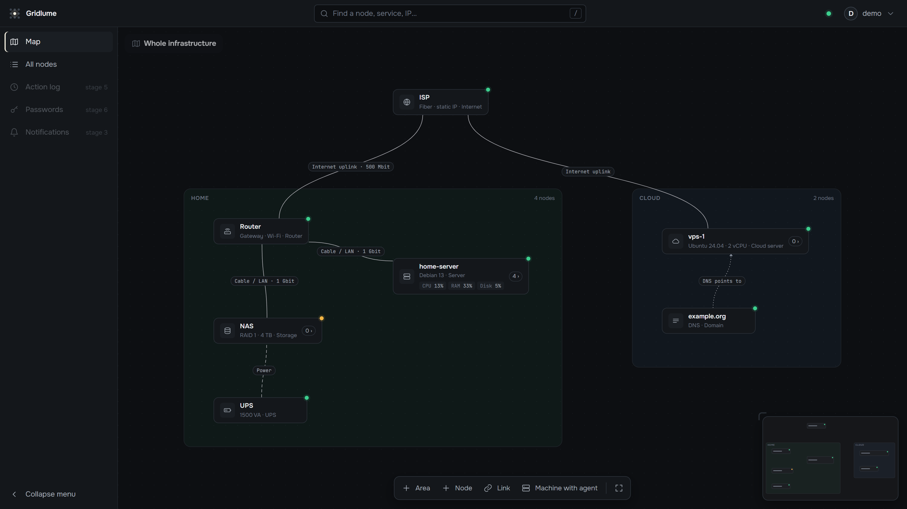
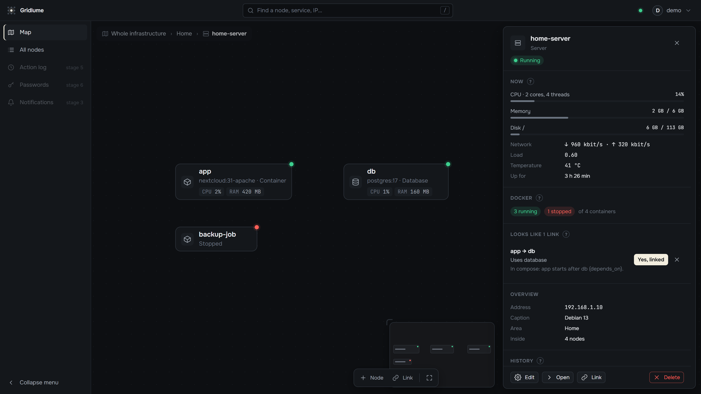

<div align="center">

# Gridlume

**Вся инфраструктура на одной схеме.**<br>
Серверы, роутеры, облако, контейнеры и связи между ними: понятно с одного взгляда, управляется из одного места.

[](https://github.com/metraveer/gridlume/actions/workflows/ci.yml)
[](https://github.com/metraveer/gridlume/releases/latest)
[](LICENSE)

[English](README.md) · Русский



</div>

> [!NOTE]
> Gridlume в ранней разработке (0.x). Уже работают схема, живые данные с машин и самообновление;
> дальше — проблемы и уведомления, действия и интеграции. См. [план](#план).

## Зачем

Обычный мониторинг показывает списки и графики. Gridlume начинается с картины того, как всё связано на
самом деле: что где живёт, что от чего зависит и что сломается, если что-то упадёт. Вы рисуете то, что
знаете, агенты дополняют остальное, а у каждой связи написано, что это и зачем.

Сделан для домашних лабораторий и небольших команд: одна небольшая программа, не нужен отдельный сервер
базы данных, понятный интерфейс на русском и английском.

## Что уже работает

- **Схема.** Области (дом, офис, облако), узлы 15 видов (роутер, сервер, VPS, контейнер, домен, ИБП…),
  связи разных типов со скоростью и заметкой, что сломается без них. Любую машину можно открыть и увидеть,
  что внутри; хлебные крошки, поиск, мини-карта, меню по правой кнопке.
- **Агенты.** Небольшая программа на каждой машине с Linux (amd64 и arm64) присылает процессор, память,
  диски, сеть и температуру, с историей. Агент сам подключается к ядру, открывать порты на машине не нужно.
- **Docker.** Контейнеры и Compose-проекты сами появляются внутри своей машины, с состоянием и ресурсами.
  Gridlume замечает вероятные связи (`app → db` по `depends_on`, общие сети) и предлагает их; подтверждаете вы.
- **Установка и обновления.** Одна команда ставит ядро как службу systemd. Обновления — подписанные выпуски
  с GitHub, ставятся из панели, с копией базы и автоматическим откатом, если новая версия не запустилась. Агенты на других машинах так же обновляются с ядра — сами или кнопкой.
- **Доступ.** Первая учётная запись создаётся по одноразовой ссылке установщика; вход, сессии, смена пароля.



## Установка

На машине с Linux и systemd (проверено на Debian 13; другие дистрибутивы с systemd тоже должны подойти), от root:

```bash
curl -fsSL https://raw.githubusercontent.com/metraveer/gridlume/main/deploy/install-core.sh | sudo sh -s -- --lang ru
```

Что делает установщик:

- запускает ядро под отдельным пользователем;
- хранит данные в `/var/lib/gridlume`;
- открывает порт 7420 только для локальной сети;
- ставит агента на эту же машину.

В конце он показывает ссылку: откройте её и создайте учётную запись владельца. Другие машины добавляются
кнопкой **«Машина с агентом»** на схеме: она даёт команду в одну строку с одноразовым кодом.

Параметры: `--channel stable|edge`, `--agent-mode user|readonly|root|none`, `--addr`, `--lang ru|en`
(описаны в начале [`install-core.sh`](deploy/install-core.sh)). Повторный запуск установщика обновляет
программу и сохраняет данные.

> [!WARNING]
> Пока Gridlume работает по обычному HTTP и рассчитан на доверенную локальную сеть. Не открывайте его в
> интернет, пока не появятся HTTPS и двухфакторный вход (запланированы к 1.0).

## Обновления

Канал выбирается в **Настройки → Обновления**:

| Канал | Что приходит |
|---|---|
| **Стабильный** (по умолчанию) | выпуски с меткой `vX.Y.Z` |
| **Свежий** | сборка на каждое изменение в `main` (`vX.Y.Z-dev.N`) и стабильные выпуски |

Каждый выпуск подписан. Ядро не ставит файлы, подпись которых не сходится со встроенным в него ключом.
Как всё устроено и что делать, если что-то пошло не так: [`docs/updates.md`](docs/updates.md).

## Как устроено

```
 браузер ──HTTP──► ядро (один файл на Go: интерфейс, API, SQLite)
                     ▲
                     │ WebSocket, ключи Ed25519; агент подключается сам
                     │
            агент на каждой машине: /proc, /sys, Docker API
```

- **Ядро:** Go, SQLite (без CGO), встроенный интерфейс на React.
- **Агент:** Go, читает систему напрямую, без лишних служб.
- **Интерфейс:** React, TypeScript, React Flow, i18next.

Принятые решения и их причины — в [`docs/decisions.md`](docs/decisions.md).

## План

| Этап | Состояние |
|---|---|
| Схема: области, узлы, связи, уровни | ✅ готово |
| Агент, живые данные, Docker | ✅ готово; живой трафик на связях в работе |
| Подписанные выпуски, обновления из панели | ✅ готово |
| Проблемы и уведомления: проверки, одно сообщение на причину, Telegram | следующий |
| Понимание: «что сломается, если…», журнал изменений, история | запланировано |
| Действия: логи, терминал, управление контейнерами с подтверждением и откатом | запланировано |
| Интеграции: хранилище паролей, Keenetic, Timeweb Cloud, ИБП (NUT), резервные копии | запланировано |
| 1.0: HTTPS, 2FA, Docker-образ, полная документация | запланировано |

Подробный план — в [`docs/plan.md`](docs/plan.md).

## Разработка

Нужны Go 1.26+ и Node.js 24+:

```bash
cd web && npm ci && cd ..
go run ./cmd/gridlume dev
```

Откройте http://127.0.0.1:7420. Ядро и Vite работают вместе, интерфейс обновляется при сохранении.
Проверки, правила и соглашения — в [CONTRIBUTING.md](CONTRIBUTING.md).

Ошибки и идеи можно присылать на русском или английском. Чужие pull request'ы начнём принимать, когда
появится соглашение участника (CLA).

## Лицензия

[AGPL-3.0](LICENSE): свободный открытый код, бесплатно на условиях лицензии. Для компаний, которым AGPL
не подходит, позже появятся коммерческая лицензия и платные функции.

Нашли уязвимость? Сообщите, пожалуйста, закрыто: см. [SECURITY.md](SECURITY.md).
